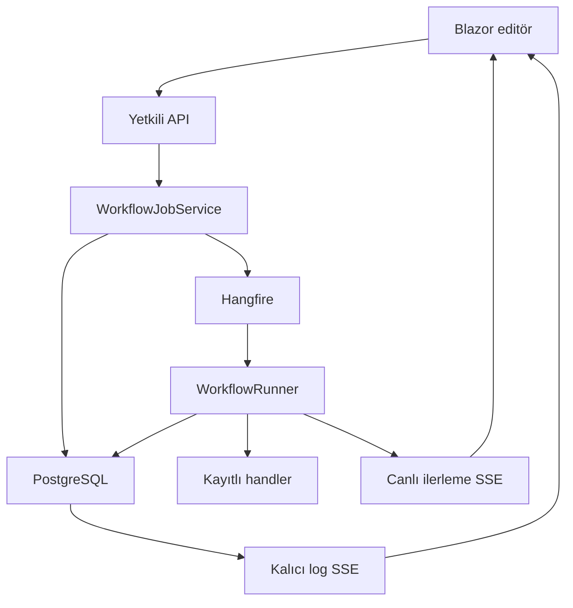

# SonOfAnton — Çekirdek mimari

Backend tek monolith, frontend Blazor WebAssembly'dir. EF Core doğrudan kullanılır; yeni Repository katmanı veya ayrı servis topolojisi yoktur.

## Yürütme

`StartAsync` execution'ı kuyruktan önce kaydeder. Anlık, gecikmeli ve adımlı API'ler aynı yolu kullanır. Job'a execution ID, tenant ID ve dahili kullanıcı ID taşınır; token saklanmaz. Worker kullanıcı/tenant aktifliğini ve workspace yazma üyeliğini tekrar denetler. Recurring wrapper her çağrıda yeni ID üretir; cron beş alanlıdır ve UTC'dir.

Runner koşullu SQL update ile `Queued → Running` geçişini alır. Aynı execution tekrar teslim edilince otomatik yürütülmez. Hangfire/node otomatik retry kapalıdır. Bu, harici sistemlerde exactly-once garantisi değildir: süreç kesilirse `Running` kayıt operatör incelemesi gerektirebilir. İptal kooperatiftir, yapılmış yan etkileri geri almaz.

## Yetki

JWT issuer/audience/lifetime doğrulanır. JIT kullanıcı/workspace/kota kaydını transaction içinde oluşturur; paralel ilk istekler aynı tenant kilidiyle korunur. API key aktif kullanıcı/tenant'a bağlıdır. Uygulama permission claim'leri standartlaştırılmıştır.

HTTP sorguları tenant, kullanıcı ve workspace üyeliğiyle filtrelenir. Genel permission yanında workspace yazma rolü gerekir; Viewer mutasyon yapamaz. Üye yönetimi Owner/Admin gerektirir. Roller metin saklandığı için SQL'de büyüklük karşılaştırması kullanılmaz. Job DbContext'i `SetJobAccess` ile açık kapsam alır. Bağlamsız DbContext güvenilen iç servis/migration/test kullanımı içindir; yeni public endpoint bu sınırı atlayamaz.

`CoreControllerFeatureProvider` dışa açılan controller listesini sınırlar. Fallback authorization kimlik doğrulama ister. Hangfire paneli kapalıdır. `X-Tenant-ID` claim ile çelişirse reddedilir; workspace header'ı üyelik sağlamaz.

## Graph ve durum

Graph en fazla 200 node/400 edge içerir; ID'ler benzersiz, bağlantılar geçerli ve döngüsüz olmalıdır. Desteklenmeyen handler/subflow kaydedilmez. Boş taslak kaydedilebilir; çalıştırma başarısız durumuna geçer. Trigger başlangıç verisini alır, çıktılar JSON olarak normalleştirilir. Workflow/revizyon aynı transaction'da ve workflow başına advisory lock altında kaydedilir. JSONB karşılaştırması metin sırasına değil içerik eşitliğine dayanır.

Log SSE veritabanından 200 kayıtlık sayfalar okur; tarihçe/canlı abonelik boşluğu yoktur. İlerleme SSE abone başına 256 event'lik kanal ve tek async writer kullanır; yavaş istemci ayrılır. Geç abonelik terminal durumu DB'den görür. Frontend Fetch + Authorization header kullanır, token URL'ye yazılmaz; özel gzip envelope kaldırılmıştır.

Pause/step ve canlı event'ler süreç içindedir. Restart sonrası checkpoint replay veya çok replica pause garantisi yoktur. Snapshot restore 501 döner.

## Sadeleştirme

RabbitMQ/MassTransit, statik legacy workflow controller ve kullanılmayan alternatif backend executor kaldırıldı. Deneysel controller, hosted servis ve plugin taraması kayıtlı değildir; kaynak ve şema geçmişi tutulur. AI flag yalnız Ollama node'larını açar; AI chat, RAG veya global vector-store API'lerini açmaz. Tam özellik geri açılışı kaynak yetkisi ve entegrasyon testleri gerektirir.
