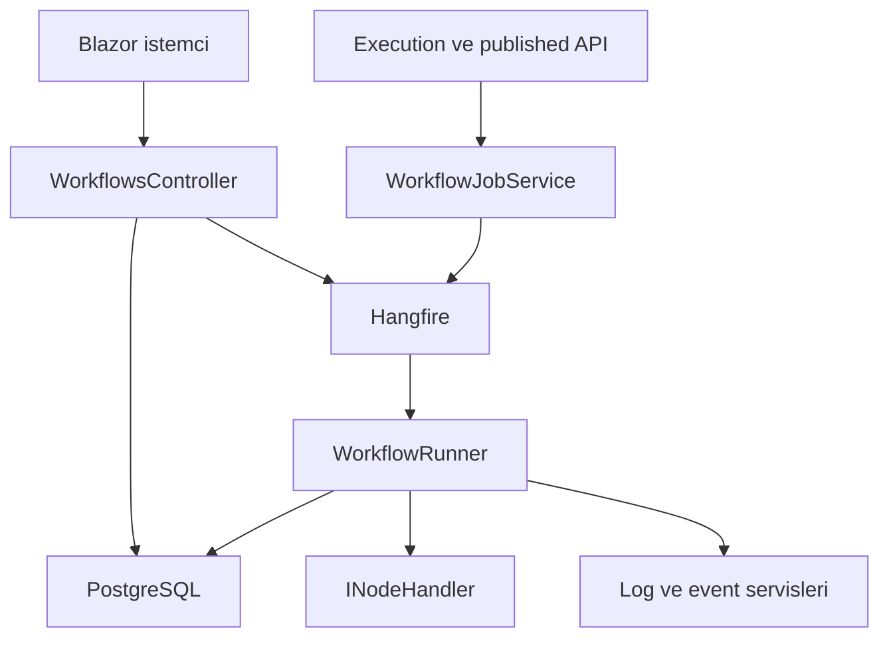

# SonOfAnton — Mevcut mimari

2 Kasım 2026, `c91a288` kaynak incelemesine dayanır. Bu belge mevcut bağlantıları anlatır; önerilen değişiklikler [REVIEW.md](REVIEW.md) içinde ayrı işaretlenmiştir.

## Uygulama sınırları

Blazor WebAssembly istemci ve ASP.NET Core backend bulunur. Backend bir monolith'tir; controller, servis, engine ve infrastructure klasörleri ayrı deploy edilen servisler değildir. EF Core doğrudan kullanılıyor; generic Repository katmanı zorunlu değildir. Hangfire server aynı backend sürecinde kayıtlıdır.

| Alan | Kaynak | Görev |
|---|---|---|
| API | `Backend/Controllers` | Workflow, execution ve diğer HTTP sözleşmeleri |
| Çalıştırma | `Backend/Engine/WorkflowRunner.cs` | Kalıcı execution üzerinde node yürütme |
| Node stratejileri | `Backend/Engine/Handlers` | `INodeHandler` implementasyonları |
| Kalıcılık | `Backend/Data`, `Backend/Migrations` | EF model ve şema geçmişi |
| Arka plan | `Backend/Services/WorkflowJobService.cs` | Hangfire enqueue/schedule/recurring |
| Kimlik | `Backend/Infrastructure/Identity` | JWT/API key bağlamı ve permission policy'leri |
| UI | `Frontend/Components`, `Frontend/Services` | Editor, API ve SSE istemcileri |
| Ortak tipler | `Shared` | DTO, entity, enum, graph ve YAML tipleri |
| Eklenti | `NodeSdk`, `templates` | Özel node sözleşmeleri/şablonları |

Tablodaki yollar `src/SonOfAnton.*` proje köklerine göredir.

## Aktif yürütme yolları

`WorkflowsController.Execute`, execution kaydını oluşturup runner'ı doğrudan kuyruğa ekler. `WorkflowJobService.ExecuteWorkflowAsync` ise execution kaydını job içinde oluşturur. Bunlar aynı giriş sözleşmesi değildir; retry ve event lifecycle davranışları birleştirilmelidir.

`WorkflowController` tekil `/api/workflow` rotasında statik liste tutar. Kalıcı `/api/workflows` API'sinin eşdeğeri değildir. Shared `GraphExecutor` ve Backend `Execution/WorkflowExecutor` için uygulama çağrısı bulunmadı; bunları aktif motor gibi belgelemek doğru olmaz. Graph veri tiplerinin frontend kullanımı ayrı değerlendirilmelidir.

## Node ve expression akışı

Runner, node tipine göre kayıtlı `INodeHandler` seçer. Parametre/expression, çıktı portu ve execution state davranışları engine kodundadır. Yeni node eklerken sınıf, DI kaydı, editor tanımı ve test birlikte güncellenmelidir. AI sentiment/classification/vision/agent sınıfları mevcut olsa da Program'daki handler kayıtları eksiktir.

Özel expression lexer/parser/interpreter, JavaScript/Jint, C#/Roslyn ve plugin assembly yükleme farklı yürütme yüzeyleridir. Hepsini MVP gereksinimi saymayın. C# script'leri backend sürecinde çalışır; güvenilmeyen kod için güvenlik izolasyonu sağlandığı iddia edilemez.

## Kimlik ve kaynak erişimi

Frontend OIDC login'i yürütür. Backend `MultiScheme` seçicisi `X-Api-Key` varsa API key handler'ına, aksi halde JwtBearer'a yönlendirir. Aktif backend kaydında interactive `AddOpenIdConnect` yoktur; `DynamicOidcEvents` dosyasının varlığı tenant başına JWT authority seçimi sağlamaz.

Tenant middleware header/subdomain sonucunu `HttpContext.Items` içine koyar; `IUserContext` tenant'ı claim'den okur. Bu iki kaynak birleştirilmiş ve üyelikle doğrulanmış bir güvenlik sınırı olarak kabul edilmemeli. Permission policy'leri kaynak sahipliği kontrolü sağlamaz; workflow sorgularında tenant/workspace filtreleri eksiktir. JWT issuer/audience ve Hangfire paneli için kritik açıklar raporda listelenmiştir.

## Durum ve gerçek zamanlı iletişim

Execution, log, checkpoint ve snapshot tabloları kalıcıdır. Pause registry, SSE kanalları ve sanal dosya sistemi süreç içindedir. Kalıcı tablo varlığı tek başına restart sonrası doğru devam etme veya yatay ölçekleme garantisi değildir.

`SseEventService` tek execution kanalını birden fazla okuyucuya verir; bu broadcast değildir. Notification ve log akışları ayrı servislerdir. Önce sahiplik doğrulaması, abone başına teslim ve bounded buffering; sonra topic/priority/metrics genişletmesi yapılmalıdır.

## AI ve ek altyapı

Semantic Kernel Ollama chat/embedding generator kullanır. Ayrı `ITextEmbeddingService` implementasyonları bulunur fakat uygulama DI kaydı yoktur; memory embedding çağrısı bundan etkilenir. Vector store 768, memory entries 384 boyutludur. Sağlayıcı değiştirmek veri boyutu/model sözleşmesini de etkiler.

RabbitMQ/MassTransit startup'a kayıtlıdır, ancak uygulama publisher/consumer kullanımı bulunmadı. Hangfire mevcut job ihtiyacını karşılayan çekirdektir. A2A, Ralph loop, Markdown watcher, marketplace, SCIM ve DataTables/Forms ayrı kapsam maliyeti getirir; bunların sadeleştirme kararları rapordadır.

## Doğrulama ve geliştirme ilkesi

Mevcut depoda test projesi/CI bulunmuyor. Önce tenant izolasyonu, auth, retry, iptal/pause, SSE ve handler çözümleme testleri eklenmeli. İhtiyaç duyulursa mevcut monolith içinde feature klasörleri kullanılabilir; ek proje veya soyutlama yalnızca somut bağımlılık sınırı varsa eklenmelidir.
