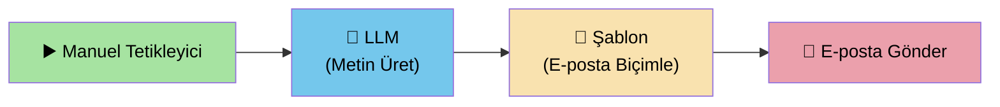
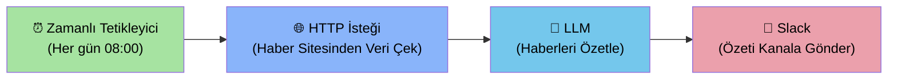
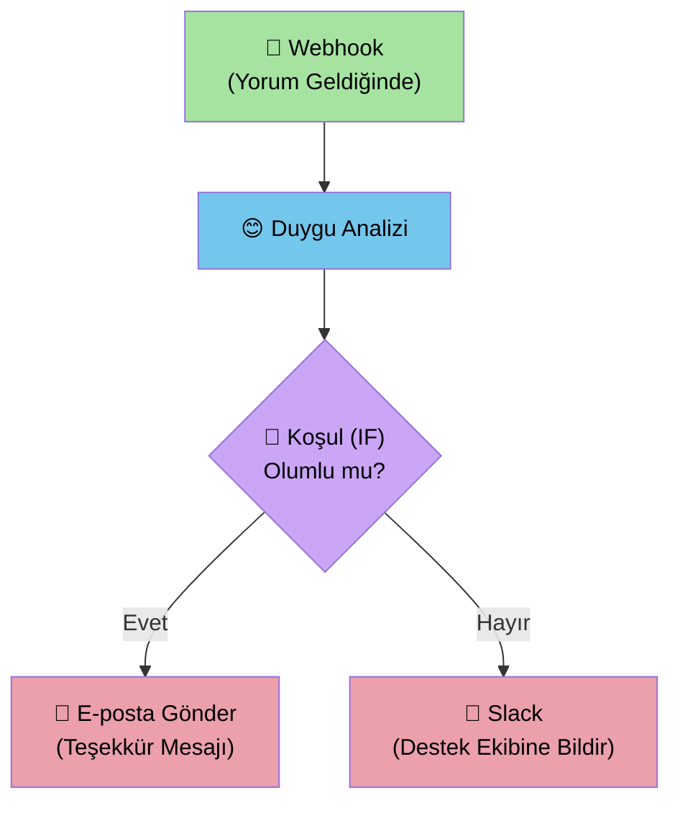
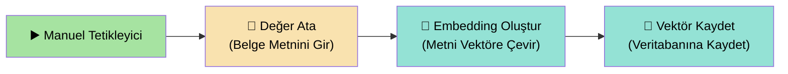
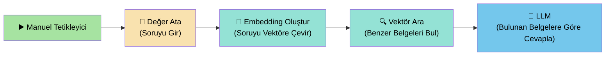
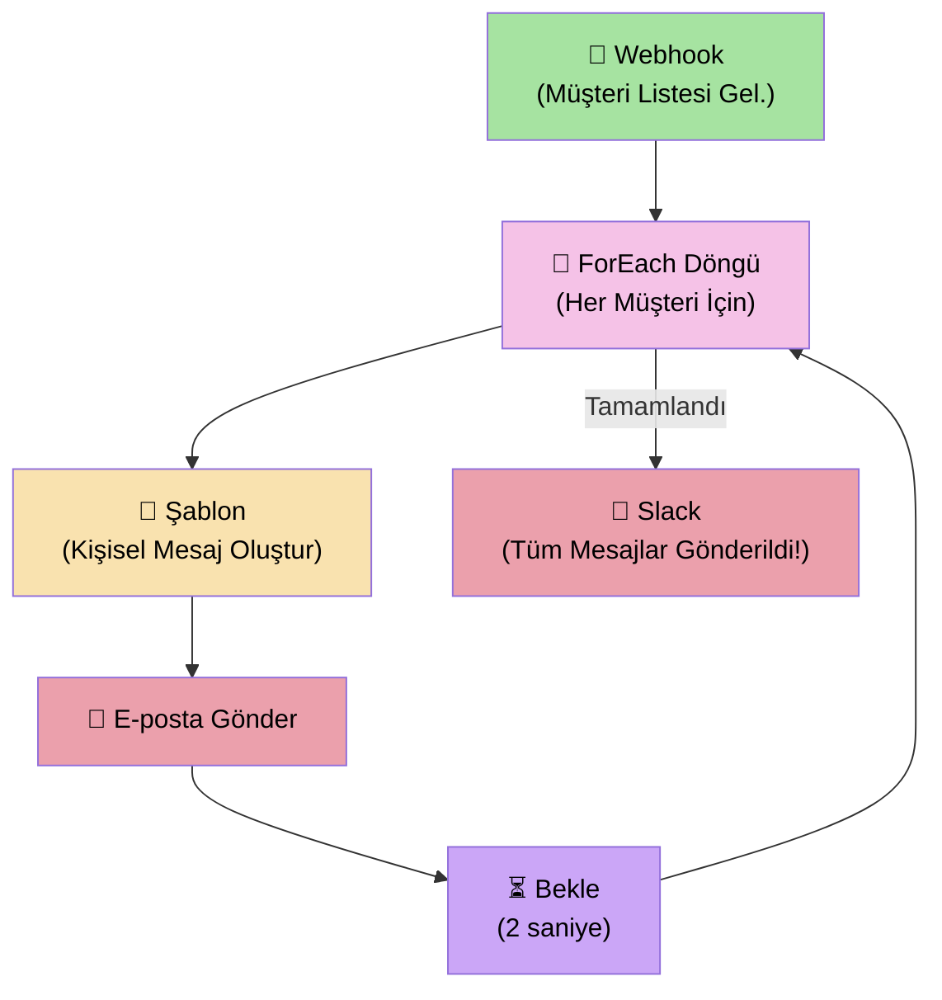

# 🚀 SonOfAnton Kullanım Rehberi

> **Bu rehber, SonOfAnton uygulamasını ilk kez kullanan kişiler için hazırlanmıştır.**
> Teknik bilgi gerektirmez. Adım adım ilerleyin, her şeyi kolayca öğreneceksiniz.

---

## 📑 İçindekiler

1. [SonOfAnton Nedir?](#-sonofanton-nedir)
2. [Giriş Yapma](#-giriş-yapma)
3. [Ana Ekranı Tanıyalım](#-ana-ekranı-tanıyalım)
4. [Yeni Bir İş Akışı Oluşturma](#-yeni-bir-iş-akışı-oluşturma)
5. [Parçaları (Node'ları) Tanıyalım](#-parçaları-nodeları-tanıyalım)
6. [Parçaları Birbirine Bağlama](#-parçaları-birbirine-bağlama)
7. [İş Akışını Çalıştırma](#-iş-akışını-çalıştırma)
8. [Sonuçları Takip Etme](#-sonuçları-takip-etme)
9. [Diğer Özellikler](#-diğer-özellikler)
10. [Örnek İş Akışları](#-örnek-iş-akışları)

---

## 🤔 SonOfAnton Nedir?

SonOfAnton, **bilgisayarınızda işleri otomatik hale getiren** bir uygulamadır.

Bunu bir **Lego seti** gibi düşünebilirsiniz:
- **Parçalar (Node'lar):** Her parça farklı bir iş yapar — "Metin üret", "E-posta gönder", "Veri ara" gibi.
- **Bağlantılar (Kablolar):** Parçaları birbirine bağlayarak verinin nereden nereye gideceğini belirlersiniz.
- **İş Akışı (Workflow):** Parçaları birleştirip "Çalıştır" düğmesine bastığınızda, kurduğunuz sistem otomatik olarak çalışır.

**Örnek:** "Her sabah saat 8'de haberleri topla, özetle ve bana e-posta at" gibi bir otomasyon kurabilirsiniz.

---

## 🔑 Giriş Yapma

Uygulamayı açtığınızda karşınıza **giriş ekranı** gelir.

### Adımlar:

1. **Kullanıcı adı** kutusuna e-posta adresinizi yazın
2. **Şifre** kutusuna şifrenizi yazın
3. **SIGN IN** (Giriş Yap) düğmesine tıklayın
4. Giriş başarılı olursa **ana ekrana** yönlendirilirsiniz

> **💡 İpucu:** Şifrenizi unuttuysanız "Forgot Password?" (Şifremi Unuttum) bağlantısına tıklayın.

---

## 🖥️ Ana Ekranı Tanıyalım

Giriş yaptıktan sonra karşınıza **ana düzenleme ekranı** gelir. Bu ekran 5 ana bölümden oluşur:

### Ekranın Bölümleri:

| # | Bölüm | Açıklama |
|---|-------|----------|
| 1 | **Üst Çubuk (Araç Çubuğu)** | En üstteki şerit. İş akışının adını değiştirebilir, kayıt, geri al, çalıştır gibi işlem düğmeleri burada. |
| 2 | **Sol Panel (Parça Listesi)** | Kullanabileceğiniz tüm parçaların (node'ların) listesi. Kategorilere ayrılmıştır. |
| 3 | **Orta Alan (Çalışma Alanı)** | Parçaları sürükleyip bırakacağınız ve birbirine bağlayacağınız ana alan. |
| 4 | **Sağ Panel (Ayarlar)** | Bir parçaya tıkladığınızda, o parçanın ayarlarını burada göreceksiniz. |
| 5 | **Alt Bölüm (Konsol)** | İş akışı çalışırken adım adım ne olduğunu buradan takip edebilirsiniz. |

---

### Üst Çubuktaki Düğmeler

| Düğme | Ne İşe Yarar? |
|-------|---------------|
| **Çalışma Alanı** | Farklı çalışma alanları arasında geçiş yaparsınız |
| **Sihirbazla Oluştur** | Adım adım yönlendirmeyle yeni iş akışı oluşturur |
| **Boş Yeni** | Sıfırdan boş bir iş akışı açar |
| **Kaydet** | Yaptığınız değişiklikleri kaydeder |
| ↩ ↪ (Oklar) | Son işlemi geri al / yeniden yap |
| **🔍 (Büyüteç)** | İş akışlarınızda arama yapar |
| **☀️/🌙 (Güneş/Ay)** | Aydınlık ve karanlık tema arasında geçiş yapar |
| **💬 (Mesaj)** | Yapay zeka asistanıyla sohbet penceresi açar |
| **Test Et** | İş akışını adım adım test eder |
| **Çalıştır** | İş akışını tam olarak çalıştırır |
| **⋮ (Üç Nokta)** | Ek menü: Pano, Geçmiş, Market ve diğer özellikler |

---

## ➕ Yeni Bir İş Akışı Oluşturma

Yeni bir iş akışı oluşturmanın **iki yolu** var:

### Yol 1: Sihirbaz ile (Kolay Yol) ✨

1. Üst çubuktaki **"Sihirbazla Oluştur"** düğmesine tıklayın
2. Ekranda açılan pencerede adımları takip edin
3. Size ne yapmak istediğiniz sorulacak; seçimlerinizi yapın
4. Sihirbaz sizin için otomatik olarak parçaları yerleştirir

### Yol 2: Boş Sayfadan (İleri Seviye)

1. **"Boş Yeni"** düğmesine tıklayın
2. Ortadaki boş çalışma alanı açılır
3. Sol panelden istediğiniz parçaları sürükleyerek çalışma alanına bırakın
4. Parçaları birbirine bağlayın

---

## 🧩 Parçaları (Node'ları) Tanıyalım

Sol panelde tüm parçalar **kategorilere** ayrılmıştır. Her birinin ne yaptığını aşağıda bulablirsiniz.

### ⚡ Tetikleyiciler — "İş akışım ne zaman başlasın?"

Bu parçalar iş akışının **nasıl başlayacağını** belirler. Her iş akışı bir tetikleyici ile başlar.

| Parça | Ne Yapar? | Örnek Kullanım |
|-------|-----------|----------------|
| **Manuel Tetikleyici** | Siz "Çalıştır" düğmesine bastığınızda başlatır | Test amaçlı çalıştırma |
| **Zamanlı Tetikleyici** | Belirttiğiniz saatlerde otomatik çalışır | "Her sabah 08:00'de çalış" |
| **Webhook** | Dışarıdan bir istek geldiğinde başlatır | Web sitenizden form gönderildiğinde |
| **Hata Tetikleyici** | Başka bir iş akışı hata aldığında başlatır | Hata bildirimi gönderme |

### 🌐 HTTP — "İnternetten veri çek"

| Parça | Ne Yapar? |
|-------|-----------|
| **HTTP İsteği** | Bir web adresine istek gönderir ve gelen yanıtı alır |

### 🔄 Dönüşüm — "Veriyi şekillendir"

| Parça | Ne Yapar? | Örnek |
|-------|-----------|-------|
| **Değer Ata** | Bir değere istediğiniz bilgiyi yazar | ad = "Ahmet" |
| **Kod** | Özel JavaScript kodu çalıştırır | Karmaşık hesaplamalar |
| **Filtre** | Belirli koşullara uyanları süzer | Fiyatı 100'den büyük olanları al |
| **Şablon** | Metin şablonu ile veri biçimlendirir | "Merhaba {{isim}}, siparişiniz hazır" |
| **Toplama** | Sayı dizisinde toplama, ortalama gibi işlemler yapar | 10 satırın toplamını hesapla |

### 🔀 Mantık — "Karara göre yönlendir"

| Parça | Ne Yapar? | Örnek |
|-------|-----------|-------|
| **Koşul (IF)** | "Eğer... ise şunu yap, değilse bunu yap" mantığı kurar | Puan > 50 ise "Geçti", değilse "Kaldı" |
| **Yönlendirici** | Veriye göre farklı yollara yönlendirir | Kategori = "A" → Yol 1, "B" → Yol 2 |
| **Birleştir** | Farklı yollardan gelen verileri tek yerde toplar | İki kaynaktan gelen verileri birleştir |
| **Bekle** | Belirtilen süre kadar bekler | 5 saniye bekle, sonra devam et |
| **Döngü** | Bir listedeki her öge için aynı işlemi tekrarlar | 100 müşterinin her birine mesaj gönder |
| **Try / Catch** | Hata olursa yakalar, iş akışı çökmez | Hata olursa log'a yaz |

### 🤖 Yapay Zeka — "Akıllı işlemler yap"

| Parça | Ne Yapar? | Örnek |
|-------|-----------|-------|
| **LLM** | Yapay zeka ile metin üretir | "Bu belgeyi 3 cümlede özetle" |
| **OpenAI** | OpenAI (ChatGPT) servisini çağırır | GPT-4 ile soru cevapla |
| **Duygu Analizi** | Metnin olumlu/olumsuz/nötr olduğunu belirler | Müşteri yorumlarını analiz et |
| **Metin Sınıflandırma** | Metni kategorilere ayırır | "Spor, Ekonomi, Siyaset" kategorileri |
| **Görüntü Analizi** | Resmi inceleyip ne olduğunu anlatır | "Bu resimde ne var?" |
| **AI Agent** | Görevleri otonom olarak yerine getirir | Karmaşık araştırma görevi |
| **Embedding** | Metni sayısal vektöre çevirir | Metin benzerliği araması için |
| **Vektör Arama** | Anlam benzerliğine göre arama yapar | "Buna en çok benzeyen belgeyi bul" |
| **YZ Planlama** | Görev planı ve ilerleme raporu yönetir | Proje takip belgeleri |

### 💾 Veri — "Veritabanı ile çalış"

| Parça | Ne Yapar? |
|-------|-----------|
| **Veritabanı** | Veritabanında sorgulama yapar (seç, ekle, güncelle, sil) |

### 📧 İletişim — "Mesaj gönder"

| Parça | Ne Yapar? |
|-------|-----------|
| **E-posta Gönder** | Belirlediğiniz adrese e-posta gönderir |
| **Slack** | Slack kanalına mesaj gönderir |

### 🔮 Vector DB — "Akıllı arama motoru"

| Parça | Ne Yapar? |
|-------|-----------|
| **Embedding Oluştur** | Metni veya resmi "anlam vektörüne" çevirir |
| **Vektör Kaydet** | Bu vektörü veritabanına kaydeder |
| **Vektör Ara** | Benzer vektörleri (benzer anlamlı metinleri) bulur |
| **Vektör Sil** | Kaydedilmiş bir vektörü siler |

### 🔁 Döngüler — "Tekrarlayan işlemler"

| Parça | Ne Yapar? |
|-------|-----------|
| **ForEach Döngü** | Bir listedeki her öge için işlem yapar |
| **While Döngü** | Koşul sağlandığı sürece tekrar eder |
| **Paralel Çalıştır** | Birden fazla işlemi aynı anda çalıştırır |
| **Döngüyü Kır** | Döngüden erken çıkar |
| **Sonraki İterasyon** | Mevcut döngü adımını atlayıp sonrakine geçer |

### 📦 Veri Deposu — "Bilgi sakla ve oku"

| Parça | Ne Yapar? |
|-------|-----------|
| **State Kaydet** | Bir anahtar-değer çifti kaydeder |
| **State Oku** | Kaydedilmiş bir değeri okur |
| **State Sil** | Kaydedilmiş bir değeri siler |
| **Tüm State'leri Oku** | Depodaki tüm verileri getirir |

---

## 🔗 Parçaları Birbirine Bağlama

Parçaları birbirine bağlamak, verinin bir parçadan diğerine akmasını sağlar.

### Adımlar:

1. Bir parçanın **sağ tarafındaki küçük noktaya** (çıkış noktası) farenizi getirin
2. Bu noktaya **tıklayıp basılı tutun**
3. Fareyi **hedef parçanın sol tarafındaki noktaya** (giriş noktası) sürükleyin
4. Bırakın — bağlantı kurulmuş olur!

> **💡 İpucu:** Çalışma alanında şu mesajı göreceksiniz:
> *"Bağlantı oluşturmak için bir çıkış portunu tutup bir giriş portuna sürükleyin"*

### Bağlantı Kuralları:

- Her iş akışı bir **tetikleyici** ile başlamalıdır
- Veriler her zaman **soldan sağa** (veya yukarıdan aşağıya) akar
- Bir parçanın birden fazla çıkışı olabilir (örneğin Koşul parçasının "doğru" ve "yanlış" çıkışları vardır)

---

## ▶️ İş Akışını Çalıştırma

İş akışınızı oluşturduktan sonra çalıştırmak için:

### Normal Çalıştırma:

1. Önce **Kaydet** düğmesine tıklayarak iş akışınızı kaydedin
2. **Çalıştır** düğmesine tıklayın
3. İş akışı başlar ve parçalar sırayla çalışır
4. Çalışırken **Durdur** düğmesiyle istediğiniz zaman durdurabilirsiniz

### Test Modu (Adım Adım):

1. **Test Et** düğmesine tıklayın
2. İş akışı ilk parçada durur
3. **İleri Sar** düğmesiyle bir sonraki adıma geçersiniz
4. Her adımda ne olduğunu görebilirsiniz
5. İsterseniz **Normal Hız** düğmesiyle kalan adımları otomatik tamamlatırsınız

> **💡 İpucu:** Test modu, iş akışınızın doğru çalışıp çalışmadığını kontrol etmek için çok yararlıdır.

---

## 📊 Sonuçları Takip Etme

### Konsol (Alt Panel)

Ekranın altındaki **Konsol** bölümünde:
- Her parçanın ne yaptığını adım adım görürsünüz
- Başarılı işlemler yeşil, hatalar kırmızı gösterilir
- **Temizle** düğmesiyle eski kayıtları silebilirsiniz
- **Otomatik kaydır** seçeneğini açarsanız, en son mesaj her zaman görünür

### Pano (Dashboard)

Üst çubuktaki **⋮** (üç nokta) menüsünden **Dashboard** seçeneğini tıklayarak:
- Toplam kaç iş akışınız olduğunu
- Kaç kez çalıştırdığınızı
- Başarı oranınızı
- En çok kullandığınız iş akışlarını görebilirsiniz

---

## 🛠️ Diğer Özellikler

### Yapay Zeka Asistanı 💬

Üst çubuktaki **mesaj simgesine** tıklayarak yapay zeka asistanıyla sohbet edebilirsiniz.
Asistana doğal dilde ne yapmak istediğinizi anlatın:

> *"Bana bir müşteri e-postalarını analiz edip olumsuz olanları Slack'e bildiren bir iş akışı kur"*

Asistan sizin için parçaları otomatik yerleştirir.

### Market (Marketplace) 🏪

Hazır iş akışı şablonları bulabileceğiniz market. **⋮** menüsünden **Marketplace** seçeneğine tıklayın.

### Chatbot Oluşturucu 🤖

Kendi sohbet robotunuzu oluşturabilirsiniz. **⋮** menüsünden **Chatbotlar** seçeneğine tıklayın.

### Değişkenler Paneli 📋

**⋮** menüsünden **Değişkenler** panelini açarak, iş akışında kullanılan tüm değişkenleri görebilir ve düzenleyebilirsiniz.

### Webhook'lar ve API Yayınlama 🌐

İş akışlarınızı dışarıdan erişilebilir hale getirebilirsiniz:
- **Webhook'lar**: Dışarıdan gelen isteklerle iş akışını tetikleyin
- **REST API Yayınla**: İş akışınızı bir web servisi olarak yayınlayın
- **API Anahtarları**: Güvenli erişim için anahtar oluşturun

### Revizyon Geçmişi 🕐

**⋮** menüsünden **Revizyon Geçmişi**'ni açarak, iş akışınızın önceki sürümlerini görebilir ve geri dönebilirsiniz.

---

## 📋 Örnek İş Akışları

Aşağıda, farklı ihtiyaçlara göre hazırlanmış **5 örnek iş akışı** bulunmaktadır. Her birini adım adım nasıl kuracağınız anlatılmıştır.

---

### Örnek 1: Basit Metin Üretme ve E-posta Gönderme ✉️

**Amaç:** Düğmeye bastığınızda yapay zeka bir metin üretsin ve bu metni e-posta olarak göndersin.

#### Kuruluş Adımları:

1. **Manuel Tetikleyici** parçasını çalışma alanına sürükleyin
2. **LLM** parçasını sürükleyin ve şu ayarları yapın:
   - Prompt: `"Bugünkü motivasyon sözünü yaz"`
3. **Şablon** parçasını sürükleyin:
   - Şablon: `"Günaydın! İşte bugünün motivasyon sözü: {{input.text}}"`
4. **E-posta Gönder** parçasını sürükleyin:
   - Alıcı: `"adresiniz@email.com"`
   - Konu: `"Günlük Motivasyon"`
5. Parçaları sırasıyla birbirine bağlayın
6. **Kaydet** → **Çalıştır**

---

### Örnek 2: Web'den Veri Çekip Özetleme 📰

**Amaç:** Bir web sitesinden veri çekin, yapay zeka ile özetletin ve Slack'e gönderin.

#### Kuruluş Adımları:

1. **Zamanlı Tetikleyici** parçasını sürükleyin:
   - Cron İfadesi: `"0 8 * * *"` (Her gün sabah 8'de)
2. **HTTP İsteği** parçasını sürükleyin:
   - URL: `"https://api.habersite.com/gundem"` (veri çekmek istediğiniz adres)
   - Metod: `GET`
3. **LLM** parçasını sürükleyin:
   - Prompt: `"Aşağıdaki haberleri 5 madde halinde Türkçe özetle: {{input.body}}"`
4. **Slack** parçasını sürükleyin:
   - Kanal: `"#gundem-ozeti"`
   - Mesaj: `"📰 Gündem Özeti:\n{{input.text}}"`
5. Parçaları sırasıyla bağlayın
6. **Kaydet** (İş akışı her sabah 8'de otomatik çalışacaktır)

---

### Örnek 3: Müşteri Yorumu Analizi ve Yönlendirme 😊😐😠

**Amaç:** Gelen müşteri yorumunu analiz edin; olumlu ise teşekkür e-postası, olumsuz ise destek ekibine bildirim gönderin.

#### Kuruluş Adımları:

1. **Webhook** parçasını sürükleyin:
   - Metod: `POST` (Web siteniz bu adrese yorum verisi gönderecek)
2. **Duygu Analizi** parçasını sürükleyin:
   - Metin: `"{{input.body.yorum}}"` (gelen yorumun metin alanı)
3. **Koşul (IF)** parçasını sürükleyin:
   - Koşul: `"{{input.sentiment}} == 'Positive'"` (olumlu mu?)
4. **Koşulun "Evet" çıkışına** → **E-posta Gönder** bağlayın:
   - Alıcı: `"{{input.body.email}}"`
   - Konu: `"Geri bildiriminiz için teşekkürler!"`
5. **Koşulun "Hayır" çıkışına** → **Slack** bağlayın:
   - Kanal: `"#musteri-destek"`
   - Mesaj: `"⚠️ Olumsuz yorum geldi: {{input.body.yorum}}"`
6. **Kaydet**

---

### Örnek 4: Belge Arama Sistemi (RAG) 🔍

**Amaç:** Belgelerinizi kaydedin ve daha sonra sorular sorarak ilgili bilgileri bulun.

#### Aşama 1: Belgeleri Kaydetme

#### Aşama 2: Soru Sorarak Arama

#### Kuruluş Adımları (Aşama 1):

1. **Manuel Tetikleyici** sürükleyin
2. **Değer Ata** sürükleyin:
   - Değerler: `{"text": "Şirket politikamız gereği yıllık izin 14 gündür..."}` (belge metni)
3. **Embedding Oluştur** sürükleyin:
   - Giriş Tipi: `Metin`
   - Model: `MiniLM (Hızlı)`
4. **Vektör Kaydet** sürükleyin:
   - Koleksiyon: `"sirket-belgeleri"`
5. Bağlayın ve çalıştırın (her belge için tekrarlayın)

#### Kuruluş Adımları (Aşama 2):

1. **Manuel Tetikleyici** → **Değer Ata** (Soru: `"Yıllık izin kaç gün?"`)
2. **Embedding Oluştur** → **Vektör Ara** (Koleksiyon: `"sirket-belgeleri"`, Sonuç Sayısı: `3`)
3. **LLM** (Prompt: `"Aşağıdaki belgelere göre soruyu cevapla: {{input.results}}"`)

---

### Örnek 5: Toplu Müşteri Mesajı Gönderme 📨

**Amaç:** Bir müşteri listesindeki her kişiye kişiselleştirilmiş e-posta gönderin.

#### Kuruluş Adımları:

1. **Webhook** parçasını sürükleyin (müşteri listesi JSON olarak gelecek)
2. **ForEach Döngü** sürükleyin:
   - Koleksiyon: `"{{input.body.musteriler}}"` (gelen müşteri dizisi)
3. **Şablon** sürükleyin:
   - Şablon: `"Sayın {{item.ad}}, {{item.urun}} ürününüz kargoya verilmiştir."`
4. **E-posta Gönder** sürükleyin:
   - Alıcı: `"{{item.email}}"`
   - Konu: `"Kargonuz Yolda!"`
5. **Bekle** sürükleyin (2000 ms — e-posta sunucusunu yormamak için)
6. Döngü tamamlandığında **Slack** ile bildirim gönderin:
   - Mesaj: `"✅ Tüm müşterilere kargo bildirimi gönderildi!"`
7. **Kaydet**

---

## ❓ Sık Sorulan Sorular

### İş akışım çalışmıyor, ne yapmalıyım?

1. Tüm parçaların birbirine **bağlı** olduğundan emin olun
2. İş akışının bir **tetikleyici** ile başladığını kontrol edin
3. **Konsol** panelindeki hata mesajlarını okuyun
4. **Test Et** modunu kullanarak adım adım kontrol edin

### Bir parçayı nasıl silerim?

Parçaya tıklayın ve klavyeden **Delete** (Sil) tuşuna basın.

### İş akışımı nasıl paylaşırım?

**⋮** menüsünden **REST API Yayınla** seçeneğiyle iş akışınızı bir web servisi olarak paylaşabilirsiniz.

### Yapılan değişiklikler otomatik kaydediliyor mu?

Evet! Uygulama **3 saniye** işlem yapılmadığında otomatik kaydeder. Ayrıca istediğiniz zaman **Kaydet** düğmesiyle manuel olarak da kaydedebilirsiniz.

### Eski halini geri getirebilir miyim?

Evet! **⋮** → **Revizyon Geçmişi** bölümünden önceki sürümlere dönebilirsiniz.

---

> **📞 Yardım mı lazım?** Uygulama içindeki **💬 Yapay Zeka Asistanı** düğmesine tıklayarak istediğiniz soruyu doğal dilde sorabilirsiniz. Asistan size adım adım yardımcı olacaktır.
